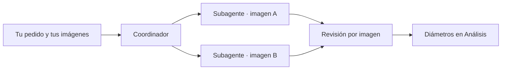

# 

[**Descargar LOCO para escritorio**](https://github.com/AzAlejandro/fiber-detector/releases/latest) · [Conectar mi agente](docs/INSTALAR_ACTUALIZAR.md) · [Imagen para la primera prueba](frontend/public/tutorial/overview-reference.png)

**¿Qué diámetros tienen las fibras de una muestra y cómo se distribuyen?** LOCO Detector permite responder a esa pregunta a partir de imágenes de microscopía electrónica de transmisión (TEM). Conecta un agente, entrégale las micrografías y pídele que las procese. En LOCO podrás ver qué fibra midió en cada círculo, revisar la escala y explorar el histograma del proyecto.

## Tu primer análisis con un agente

1. **Instala LOCO y conecta el agente.** La edición de escritorio está disponible para **Windows x64** y **macOS 15 o posterior con Apple Silicon**. Si usas Codex u otro agente con acceso a tu equipo, puedes escribir «Instala LOCO desde github.com/AzAlejandro/fiber-detector y conecta mi agente». La guía incluye los comandos de conexión mediante MCP. [Instalación paso a paso](docs/INSTALAR_ACTUALIZAR.md)
2. **Comprueba la conexión.** Abre **Configuración → Conexión → Comprobar conexión** en LOCO. Después pídele al agente «Dime qué proyecto está activo en LOCO». En una biblioteca nueva puedes crear el primero desde el mismo pedido.
3. **Adjunta una micrografía al chat y prueba este pedido.** También puedes darle una carpeta de imágenes a la que tenga acceso.

   > Crea un proyecto llamado «Primer ensayo» y procesa esta imagen hasta obtener los diámetros. Comprueba la escala, guarda las mediciones y dime cuántas quedaron registradas y cuáles necesitan revisión.

4. **Abre Análisis.** En **Selección de imágenes**, elige «Primer ensayo» por su nombre. El indicador verde señala el proyecto que estás revisando. Comprueba la escala y el recuento de cada imagen, selecciona las que quieras incluir y abre **Histograma**.

## Cómo pasa LOCO de una fibra a un diámetro

Cada círculo debe abarcar una sola fibra. Sus dos bordes cruzan el perímetro en cuatro puntos. El segmento amarillo del esquema muestra el ancho transversal que se quiere medir. En la interfaz puedes volver al círculo y comprobar si los dos bordes pertenecen a la misma fibra.

**La escala se calibra por imagen.** En una regla graduada, marca dos graduaciones consecutivas y asigna la longitud física de ese intervalo. Por ejemplo, si el proyecto establece **1 µm por tramo**, introduce **1 µm**. Si la leyenda describe la regla completa, divide ese valor por el número de intervalos iguales. En una barra simple, marca ambos extremos y usa el valor completo.

## Qué puedes delegar

Cuando entregas un lote, el coordinador asigna un subagente a cada archivo. En un proceso completo, cada uno guarda los trazos, la máscara, los círculos, los cruces y los diámetros de su imagen. Después, el coordinador reabre las imágenes y comprueba la escala, las marcas y los objetivos antes de entregar las mediciones. [Guía del agente](.agents/skills/loco-inicio/SKILL.md) · [Criterios de revisión](.agents/skills/loco-revision/SKILL.md)

| Cuando quieres… | Prueba este pedido en el chat |
|---|---|
| Procesar un lote con objetivos | «Procesa estas imágenes. Usa como objetivos un 40 % del campo útil pintado y 70 círculos por imagen. Informa lo alcanzado y cualquier diferencia». |
| Revisar la máscara antes de medir | «Pinta fibra, halo y fondo en esta imagen, genera la máscara y detente para que la revise». |
| Continuar desde lo guardado | «Retoma los círculos de este proyecto, completa los cruces pendientes y registra los diámetros». |
| Comparar dos ensayos sobre los mismos TIFF | «Crea otro proyecto e importa copias independientes de estas imágenes. Quiero comparar los dos ensayos en Análisis». |

En **Configuración → Objetivos** puedes guardar la cobertura de pintura, la cantidad de círculos y sus márgenes para el proyecto. El **modo Agente** está activo por defecto. En **Configuración → Conexión → Modelo para nuevos agentes** puedes elegir **GPT-6.2 Sol** (predeterminado) o **GPT-6.2 Astra**. La elección se guarda para los siguientes subagentes.

## Trabajar con los resultados

- **Revisar una muestra.** Filtra por proyecto, imagen o etiquetas, inspecciona los diámetros individuales y compara su distribución. Puedes exportar el histograma en SVG y los datos en CSV.
- **Repetir un ensayo.** Las copias independientes conservan las marcas, calibraciones y mediciones de cada proyecto. En **Configuración → Exportar** puedes guardar un ZIP del proyecto para llevarlo a otra instalación.
- **Entrenar un detector.** La interfaz completa incluye preparación de datasets, entrenamiento de modelos y validación de candidatos. Puedes abrirla desactivando **Modo Agente** en Configuración. [Referencia técnica y API](docs/REFERENCIA_TECNICA.md)

[Historial de versiones](CHANGELOG.md) · [Distribución Docker](docs/GITHUB_RELEASES_WINDOWS_MAC.md) · [Preparar el escritorio](docs/PREPARAR_ESCRITORIO.md) · [Seguridad](SECURITY.md) · [Licencia MIT](LICENSE)
