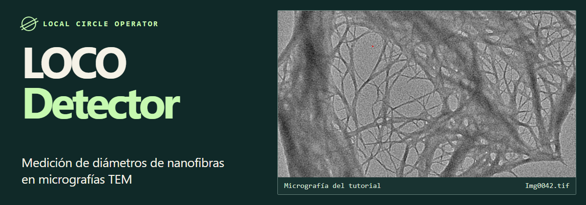
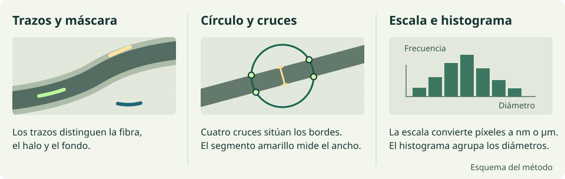
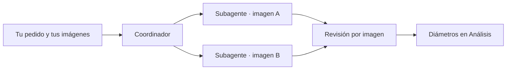

# 

[**Cómo instalar LOCO**](#cómo-instalar-loco) · [Conectar mi agente](docs/INSTALAR_ACTUALIZAR.md#conectar-un-agente) · [Imagen para la primera prueba](frontend/public/tutorial/overview-reference.png)

**¿Qué diámetros tienen las fibras de una muestra y cómo se distribuyen?** LOCO Detector permite responder a esa pregunta a partir de imágenes de microscopía electrónica de transmisión (TEM). Conecta un agente, entrégale las micrografías y pídele que las procese. En LOCO podrás ver qué fibra midió en cada círculo, revisar la escala y explorar el histograma del proyecto.

## Cómo instalar LOCO

La edición de escritorio incluye el motor y la interfaz. Si utilizas un agente con acceso a tu equipo, puedes pedirle **«Instala LOCO desde https://github.com/AzAlejandro/fiber-detector, conecta mi agente y comprueba que funciona»**. También puedes instalarlo manualmente en tres pasos.

### Windows x64

1. [Descarga el instalador de Windows (.exe)](https://github.com/AzAlejandro/fiber-detector/releases/latest/download/LOCO-Windows-x64.exe).
2. Abre `LOCO-Windows-x64.exe` y sigue el asistente. Conserva la carpeta de destino propuesta si después vas a conectar Codex con los comandos de la guía.
3. Al terminar, selecciona **Abrir LOCO Detector**. En adelante puedes abrirlo desde el menú **Inicio**.

### macOS 15 o posterior con Apple Silicon

1. [Descarga el instalador de Mac (.dmg)](https://github.com/AzAlejandro/fiber-detector/releases/latest/download/LOCO-macOS-arm64.dmg).
2. Abre el DMG. En Finder, pulsa **⌘⇧G**, escribe `~/Applications` y pulsa **Intro**. Si la carpeta aún no existe, créala en tu carpeta de usuario con el nombre `Applications`.
3. Arrastra `LOCO.app` desde el DMG a esa carpeta. Abre la copia que acabas de instalar.

**Comprueba la instalación.** LOCO abre la interfaz en tu navegador. Si la pestaña no aparece, abre `http://127.0.0.1:5181` mientras LOCO está en ejecución. En **Configuración → Conexión → Comprobar conexión** verás la versión y el estado del motor. Las notas de la versión incluyen las sumas SHA-256 y el estado de firma de los instaladores. [Notas y archivos de la versión estable](https://github.com/AzAlejandro/fiber-detector/releases/latest)

## Tu primer análisis con un agente

1. **Conecta el agente.** Si hiciste la instalación manual, registra el conector local de LOCO en tu agente. La guía incluye los comandos de Codex para Windows y Mac. [Conectar un agente mediante MCP](docs/INSTALAR_ACTUALIZAR.md#conectar-un-agente)
2. **Prueba el conector.** En un chat nuevo, pídele al agente «Dime qué versión de LOCO está instalada y qué proyecto está activo». En una biblioteca nueva puedes crear el primer proyecto en el siguiente paso.
3. **Adjunta una micrografía al chat y prueba este pedido.** También puedes darle una carpeta de imágenes a la que tenga acceso.

   > Crea un proyecto llamado «Primer ensayo» y procesa esta imagen hasta obtener los diámetros. Comprueba la escala, guarda las mediciones y dime cuántas quedaron registradas y cuáles necesitan revisión.

4. **Abre Análisis.** En **Selección de imágenes**, elige «Primer ensayo» por su nombre. El indicador verde señala el proyecto que estás revisando. Comprueba la escala y el recuento de cada imagen, selecciona las que quieras incluir y abre **Histograma**.

## Cómo pasa LOCO de una fibra a un diámetro

Cada círculo debe abarcar una sola fibra. Sus dos bordes cruzan el perímetro en cuatro puntos. El segmento amarillo del esquema muestra el ancho transversal que se quiere medir. En la interfaz puedes volver al círculo y comprobar si los dos bordes pertenecen a la misma fibra.

**La escala se calibra por imagen.** En las micrografías TEM, calibra con la barra inferior completa. En una regla graduada, marca el centro de la primera graduación y el de la última. En una barra continua, marca sus dos extremos. Guarda una sola vez el valor y la unidad impresos. Una barra de diez intervalos rotulada 1 µm mide 1 µm de extremo a extremo.

## Qué puedes delegar

En **Entrenamiento del agente → Biblioteca de skills → Lectura visual del proyecto** puedes describir cómo se ve una fibra en tus imágenes y guardar ejemplos con su nombre o número de círculo. Los agentes reciben la versión vigente al pintar, escoger círculos y medir sus bordes.

Cuando entregas un lote, el coordinador asigna un subagente a cada archivo. En un proceso completo, cada uno guarda los trazos, la máscara, los círculos, los cruces y los diámetros de su imagen. Después, el coordinador reabre las imágenes y comprueba la escala, las marcas y los objetivos antes de entregar las mediciones. [Guía del agente](.agents/skills/loco-inicio/SKILL.md) · [Criterios de revisión](.agents/skills/loco-revision/SKILL.md)

| Cuando quieres… | Prueba este pedido en el chat |
|---|---|
| Procesar un lote con objetivos | «Procesa estas imágenes. Usa como objetivos un 40 % del campo útil pintado y 70 círculos por imagen. Informa lo alcanzado y cualquier diferencia». |
| Revisar la máscara antes de medir | «Pinta fibra, halo y fondo en esta imagen, genera la máscara y detente para que la revise». |
| Continuar desde lo guardado | «Retoma los círculos de este proyecto, completa los cruces pendientes y registra los diámetros». |
| Comparar dos ensayos sobre los mismos TIFF | «Crea otro proyecto e importa copias independientes de estas imágenes. Quiero comparar los dos ensayos en Análisis». |

En **Configuración → Objetivos** puedes guardar la cobertura de pintura, la cantidad de círculos y sus márgenes para el proyecto. El **modo Agente** está activo por defecto. En **Configuración → Conexión → Modelo para nuevos agentes** puedes elegir **GPT-6.2 Sol** (predeterminado) o **GPT-6.2 Astra**. La elección se guarda para los siguientes subagentes.

## Trabajar con los resultados

En **Configuración → Procesamiento** puedes elegir los filtros de máscara y detección para las siguientes ejecuciones. Por defecto están activos el suavizado inicial, la corrección local del fondo y la continuidad longitudinal. Puedes activar por separado el alineamiento, la poda del esqueleto, el contraste adaptativo (CLAHE) y el realce por orientación. En los círculos, **D · Tres perfiles transversales** ajusta los extremos del diámetro cuando tres cortes vecinos concuerdan. Puedes volver a **Anterior · Geometría de la máscara** en el mismo panel. Ambos métodos conservan el círculo y sus contactos.

El **muestreo por zonas** divide el campo útil en 2 filas y 4 columnas de forma predeterminada. Cada zona recibe una parte de los círculos solicitados proporcional a su área de fibra en la máscara. Una zona vacía recibe cero. Los círculos deben corresponder a tramos medibles, con separación y cuatro contactos, incluso cuando sobra cupo. Puedes cambiar la cuadrícula, desactivar la redistribución de sobrantes o volver al muestreo anterior. En **Detección de fibras y bordes → Distribución al detectar** puedes comparar el cupo y los círculos colocados y superponer la cuadrícula a la imagen.

- **Revisar una muestra.** Filtra por proyecto, imagen o etiquetas, inspecciona los diámetros individuales y compara su distribución. Puedes exportar el histograma en SVG y los datos en CSV.
- **Repetir un ensayo.** Las copias independientes conservan las marcas, calibraciones y mediciones de cada proyecto. En **Configuración → Exportar** puedes guardar un ZIP del proyecto para llevarlo a otra instalación.
- **Entrenar un detector.** La interfaz completa incluye preparación de datasets, entrenamiento de modelos y validación de candidatos. Puedes abrirla desactivando **Modo Agente** en Configuración. [Referencia técnica y API](docs/REFERENCIA_TECNICA.md)

[Historial de versiones](CHANGELOG.md) · [Distribución Docker](docs/GITHUB_RELEASES_WINDOWS_MAC.md) · [Preparar el escritorio](docs/PREPARAR_ESCRITORIO.md) · [Seguridad](SECURITY.md) · [Licencia MIT](LICENSE)
